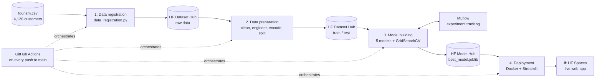
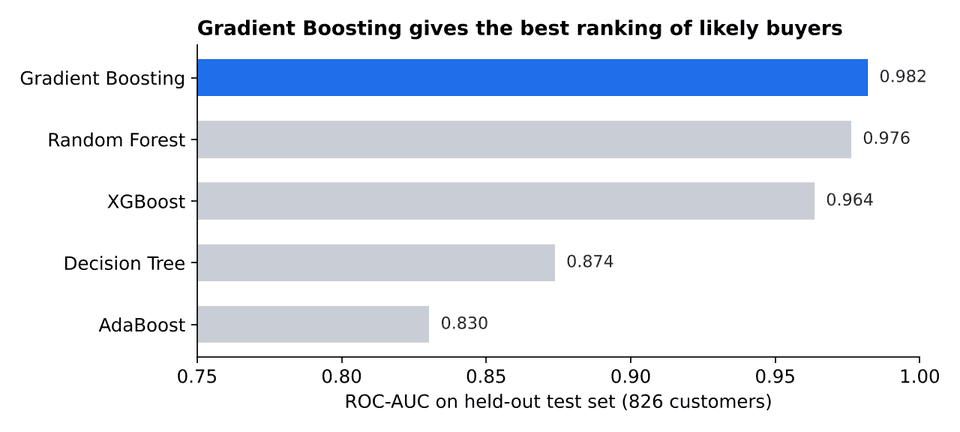
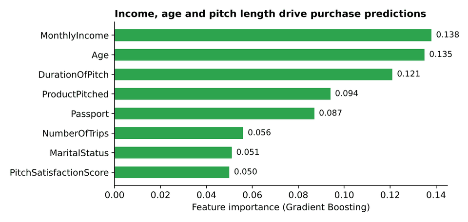

<div align="center">

# 🏝️ Tourism Package Prediction: an End-to-End MLOps Pipeline

**Predict which customers will buy a Wellness Tourism Package before the sales team picks up the phone.**

[](https://huggingface.co/spaces/u2jyothibhat/tourism_project)
[](https://huggingface.co/u2jyothibhat/tourism-package-prediction-model)
[](https://huggingface.co/datasets/u2jyothibhat/tourism_project)
[](https://github.com/u2jyothibhat/tourism-package-prediction/actions/workflows/pipeline.yml)


</div>

---

## ✨ Highlights

- **0.98 ROC-AUC** on a held-out test set of 826 customers, with 94% accuracy and 92% precision (Gradient Boosting).
- **Fully automated MLOps.** One push to `main` registers the data, prepares it, trains five models, picks the best one and redeploys the app.
- **Everything is versioned on Hugging Face Hub:** the raw dataset, the train and test splits, the model and the live app.
- **Experiment tracking with MLflow:** every model's parameters and metrics are logged and comparable.
- **A business-friendly web app** where a sales or marketing user enters a customer profile and gets a purchase probability instantly.

## 🎯 The business problem

"Visit with Us", a travel company, wants to launch a **Wellness Tourism Package**. Only about **1 in 5** customers bought a package in the past, so calling everyone is expensive and slow.

This project builds a model that scores each customer's likelihood to buy, so the team can:

| Goal | How the model helps |
|---|---|
| Spend marketing budget wisely | Focus calls and offers on high-probability customers |
| Shorten the sales cycle | Prioritise the lead list before the first contact |
| Keep improving | Retrain and redeploy automatically whenever new data arrives |

## 🏗️ Architecture



## 📊 Results

Five algorithms are tuned with 5-fold `GridSearchCV` on ROC-AUC and compared on the same held-out test set.



| Model | ROC-AUC | Accuracy | Precision | Recall | F1 |
|---|---:|---:|---:|---:|---:|
| **Gradient Boosting** 🏆 | **0.982** | **0.942** | 0.924 | **0.761** | **0.834** |
| Random Forest | 0.976 | 0.924 | 0.929 | 0.654 | 0.768 |
| XGBoost | 0.964 | 0.941 | **0.930** | 0.748 | 0.829 |
| Decision Tree | 0.874 | 0.886 | 0.760 | 0.597 | 0.669 |
| AdaBoost | 0.830 | 0.844 | 0.653 | 0.403 | 0.498 |

*Test set: 826 customers (20% stratified split, `random_state=42`). The numbers come from rerunning `model_building.py`'s search grids on the committed `data/train_data.csv` and `data/test_data.csv`; MLflow logs the same metrics on every pipeline run.*

### What drives a purchase?



Monthly income, age and the length of the sales pitch matter most, followed by the product pitched and whether the customer holds a passport.

## 🗂️ The data

4,128 customer records with 18 features plus the target, `ProdTaken` (1 = bought a package).

| Group | Features |
|---|---|
| **Customer profile** | Age, Gender, MaritalStatus, CityTier, Occupation, Designation, MonthlyIncome, Passport, OwnCar |
| **Travel preferences** | NumberOfPersonVisiting, NumberOfChildrenVisiting, NumberOfTrips, PreferredPropertyStar |
| **Sales interaction** | TypeofContact, DurationOfPitch, ProductPitched, NumberOfFollowups, PitchSatisfactionScore |
| **Engineered** | IncomeCategory (4 income bands), AgeGroup (5 age bands) |

**Preparation steps:** median and mode imputation for missing values, a fix for the inconsistent `"Fe Male"` gender label, income and age banding, label encoding of categorical columns, and a stratified 80/20 train/test split.

## 🚀 Quick start

```bash
# 1. Clone
git clone https://github.com/u2jyothibhat/tourism-package-prediction.git
cd tourism-package-prediction

# 2. Create an environment and install dependencies
python -m venv .venv && source .venv/bin/activate
pip install -r tourism_project/requirements.txt

# 3. Add your Hugging Face token (needs write access)
export HF_TOKEN="hf_..."

# 4. Run the pipeline step by step
cd tourism_project
python data_registration.py      # upload raw data to the HF Hub
python data_preparation.py       # clean, engineer, split and upload train/test
mlflow ui --port 5000 &          # optional: watch the experiments
python model_building.py         # train, compare and register the best model
cd deployment && python deploy_to_hf.py   # publish the Streamlit app
```

**Run the app locally with Docker:**

```bash
cd tourism_project/deployment
docker build -t tourism-app .
docker run -p 8501:8501 tourism-app
# open http://localhost:8501
```

## 🔁 CI/CD pipeline

[`.github/workflows/pipeline.yml`](.github/workflows/pipeline.yml) runs on every push to `main` (or manually):

| Job | What it does |
|---|---|
| `register-dataset` | Uploads the raw dataset to the Hugging Face Hub |
| `data-prep` | Cleans and engineers features, and publishes the train/test splits |
| `model-training` | Starts MLflow, tunes five models and registers the best one |
| `deploy-hosting` | Pushes the Streamlit app to Hugging Face Spaces |

Add `HF_TOKEN` as a repository secret (**Settings → Secrets and variables → Actions**) to run it in your own fork.

## 🖥️ The web app

The [Streamlit app](https://huggingface.co/spaces/u2jyothibhat/tourism_project) gives business users:

- an input form for the customer's profile and sales interaction;
- a buy or no-buy prediction with a confidence score;
- a probability breakdown chart and a customer profile summary.

## 📁 Project structure

```
tourism-package-prediction/
├── .github/workflows/pipeline.yml   # CI/CD: data → train → deploy
├── docs/                            # README charts
└── tourism_project/
    ├── data_registration.py         # step 1: raw data to the HF Hub
    ├── data_preparation.py          # step 2: clean, engineer, split
    ├── model_building.py            # step 3: train, tune, track, register
    ├── requirements.txt
    ├── tourism.csv                  # raw dataset
    ├── data/                        # train_data.csv, test_data.csv
    ├── model_building/              # best_model.joblib
    └── deployment/
        ├── app.py                   # Streamlit app
        ├── Dockerfile
        ├── requirements.txt
        └── deploy_to_hf.py          # step 4: publish to HF Spaces
```

## 🧰 Tech stack

| Area | Tools |
|---|---|
| Machine learning | scikit-learn, XGBoost |
| Experiment tracking | MLflow |
| Data and model registry | Hugging Face Hub (Datasets and Models) |
| App and serving | Streamlit, Docker, Hugging Face Spaces |
| Automation | GitHub Actions |

## 🛣️ Ideas for next steps

- [ ] Tune the decision threshold for higher recall, so fewer likely buyers are missed
- [ ] Add SHAP explanations to the app, so sales teams see *why* a customer scores high
- [ ] Add data validation and model drift monitoring between retraining runs
- [ ] Add unit tests and a test job to the CI pipeline

## 🤝 Contributing

Contributions are welcome. Fork the repo, create a feature branch, and open a pull request. If you find this project useful, please consider giving it a ⭐.

## 👩‍💻 Author

**Jyothi Kodenkiri**: technology leader in AI, MLOps and hybrid cloud, and author of *[Forward Deployed Engineer](https://www.amazon.com/dp/B0HNSNJLWD/)* and *[Site Reliability Engineering for AI](https://www.amazon.com/dp/B0HNT8Z95S/)*.

[](https://www.linkedin.com/in/jyothi-k-89bb423/)
[](https://github.com/u2jyothibhat)
